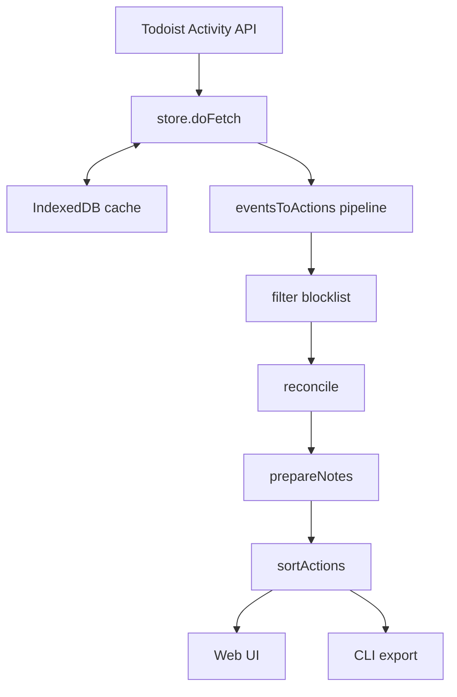

# Reviewist — Code Walkthrough

<!-- markdownlint-disable MD013 -->

## The Problem

Todoist has no usable way to review completed tasks. The Activity Log is an audit trail, not a review tool. Recurring task completions don't appear in project completed-task lists at all. There are no filters that can query completed tasks.

Reviewist fixes this: it fetches the raw activity log, reconciles complete/uncomplete pairs, deduplicates recurring tasks, and presents them grouped by day with project-based filtering. There's also a CLI that exports the same data as markdown for Obsidian.

The whole thing runs client-side — no backend. Todoist's API supports CORS, so direct `fetch()` works from the browser.

## Vocabulary

Reviewist uses bujo-inspired terms distinct from Todoist's:

- **Action** = a completed Todoist task (checkmark, completion time)
- **Note** = an uncompletable Todoist task (created with a `*` prefix in Todoist). Rendered with an emoji in the gutter instead of a checkmark. Lives in designated "note projects" (Aside, Within).

## Architecture at a Glance



The data flows through a shared processing pipeline, then diverges into two rendering paths. Let's follow the data from API to screen.

---

## 1. The Data Shapes

Everything flows through a small set of types. These are worth seeing because they define what travels through the pipeline.

```typescript
export interface CompletedAction {
  content: string;
  completed_at: string;
  project_id: string;
  task_id: string;
  id: string;
}

export interface Project {
  name: string;
  color: string | null;
}

export interface DedupedAction extends CompletedAction {
  count: number;
  allTimes: string[];
}

export type StatusType = "error" | "info" | null;

export type ActivityEventType = "completed" | "uncompleted";

export interface ActivityEvent {
  id: unknown; // Large number, loses precision as JSON float — do not use as key
  event_date: string;
  event_type: ActivityEventType;
  object_id: string;
  object_type: string;
  parent_project_id: string | null;
  parent_item_id: string | null;
  initiator_id: string;
  extra_data: {
    content?: string;
    client?: string;
    note_count?: number;
  };
}
```

**ActivityEvent** is the raw API shape. The `id` field is a huge float that loses precision in JSON — the app uses `object_id|event_date` as a composite key instead. Task text lives in `extra_data.content`.

**CompletedAction** is the app's internal model after reconciliation: one per surviving completion. Fields use Reviewist's domain vocabulary.

**DedupedAction** adds `count` and `allTimes[]` for recurring tasks completed multiple times in a day — the UI renders "Take vitamins ×3" with a tooltip listing all timestamps.

---

## 2. Fetching from Todoist

`api.ts` has two functions: `fetchProjects` (project list) and `fetchActivityEvents` (activity log with cursor-based pagination). Both are plain `fetch()` with a bearer token — no SDK, because the Todoist TypeScript SDK bundles `undici` (~600KB).

The activity log is the _only_ endpoint that captures recurring task completions. The v1 `/tasks/completed/by_completion_date` endpoint silently omits them.

The API returns events newest-first. The caller (the store) reverses this to chronological order for full fetches but preserves the order for incremental merge.

---

## 3. Reconciliation

When you uncomplete a task in Todoist, the activity log gets both a `completed` and an `uncompleted` event. Reconciliation cancels them out. This is the core of `reconcile.ts`.

```typescript
// Single walk: coalesce events per task, uncompletes pop the latest
const byId = new Map<string, ActivityEvent[]>();
for (const e of events) {
  if (e.event_type === "completed") {
    let list = byId.get(e.object_id);
    if (!list) {
      list = [];
      byId.set(e.object_id, list);
    }
    list.push(e);
  } else {
    byId.get(e.object_id)?.pop();
  }
}
```

After sorting events chronologically, the algorithm walks through them once: `completed` events push onto a per-task stack; `uncompleted` events pop the most recent completion off. Whatever survives in the stacks becomes a `CompletedAction`.

This handles recurring tasks correctly — a recurring "Take vitamins" completed 5 times produces 5 stack entries sharing one `object_id`. Uncompleting one only pops the most recent; the other 4 survive.

---

## 4. Event Merging and Incremental Fetching

Reviewist caches raw events in IndexedDB. On page load, it renders from cache immediately, then does an incremental fetch. `events.ts` handles the merge.

Two constants drive the strategy:

- **SIX_WEEKS_MS** (42 days) — maximum history window; older events get evicted
- **OVERLAP_MS** (1 hour) — incremental fetches start from `newest_cached - 1hr` to handle Clickhouse eventual consistency (Todoist's activity log is Clickhouse-backed, and events may appear with a slight delay)

`mergeEvents` concatenates old + new, deduplicates by `object_id|event_date`, sorts chronologically, and evicts events older than 6 weeks. The 1-hour overlap means some events appear in both arrays — dedup handles that cleanly.

---

## 5. The Actions Pipeline

`actions.ts` is the largest module. It transforms reconciled `CompletedAction[]` into the grouped, sorted, deduplicated data the UI renders. The main entry point chains everything:

```bash
sed -n '121,130p' src/lib/actions.ts
```

```typescript
export function eventsToActions(
  events: ActivityEvent[],
  projects: Record<string, Project>,
  blocklist: ReadonlySet<string>,
  noteProjectIds: Set<string>,
): CompletedAction[] {
  const filtered = events.filter((e) => !blocklist.has(e.object_id));
  const actions = prepareNotes(reconcile(filtered), noteProjectIds, projects);
  return sortActions(actions, projects, noteProjectIds);
}
```

Three lines composing four stages:

1. **Filter blocklist** — a hardcoded set of orphaned task IDs (from test tasks that were completed then deleted — the activity log keeps these forever)
2. **Reconcile** — complete/uncomplete pairing (section 3)
3. **prepareNotes** — for tasks in note projects: strips the `*` prefix, prepends a default emoji if the content doesn't already start with one (🗓️ for Aside, 💬 for Within)
4. **sortActions** — canonical order: notes first (grouped by project, alphabetical within), then regular actions by completion time

The sort uses `sortKey()` which finds the first Unicode letter, skipping leading emoji — so "🗓️ Doctor appointment" sorts under "d", not under the emoji codepoint.

### Dedup and Day Grouping

`dedup()` collapses recurring tasks by `content||project_id` — tracking count and all timestamps. `groupActionsByDay()` builds the final display structure: buckets by local date, deduplicates per day, groups by project (with hex colors for borders), and sorts days newest-first.

The day bucketing uses `fmtLocalDate` (local timezone), not `fmtDate` (UTC). This matters: an action completed at `2026-02-20T23:30:00Z` should appear under Feb 21 for a CET user. The codebase has two parallel date-formatting paths — UTC for API parameters, local for everything user-facing — and the comments in `dates.ts` are explicit about which is which.

---

## 6. The Store — Orchestrating Everything

`store.svelte.ts` is the brain. It manages all reactive state (Svelte 5 `$state` runes) and coordinates fetching, caching, and incremental updates.

Key design decisions:

**`cachedEvents` is deliberately non-reactive.** It's the raw event buffer for incremental fetch logic — no reason for the UI to re-render when it changes. Everything else that the UI reads (`allActions`, `projects`, `fetching`, etc.) is `$state`.

**`doFetch()` flow:**

1. On first call, load from IndexedDB → render immediately from cache
2. Determine fetch range: `newest_event - 1hr` (incremental) or full 6-week window (cold)
3. Fetch projects and events in parallel via `Promise.all`
4. Merge (incremental) or sort (full), then run `eventsToActions`
5. Compare result against current state via `JSON.stringify` — skip reactive update if nothing changed (prevents spurious re-renders during auto-refresh)
6. Save merged events to IndexedDB (using `$state.snapshot()` to unwrap Svelte proxies, which IDB can't serialize)

**Error resilience:** If the API fails but we have cached data, the app silently continues showing the cached view. Errors only surface when there's no cache at all.

**Auto-refresh** is a Svelte 5 `$effect` that sets up a `setInterval` — re-runs when token or interval changes, cleaning up via the returned destructor.

---

## 7. The Cache

`cache.ts` persists raw events and projects in IndexedDB (single record, key `'state'`). On save it stores `eventCount` and a SHA-256 hash of the serialized events alongside the data. On load, two integrity checks run:

1. **Structural**: does `events.length` match the stored `eventCount`?
2. **Content hash**: does SHA-256 of the events match the stored hash?

If either fails, the cache is discarded and a full fetch happens. This defends against corruption from storage pressure, browser bugs, or extension interference.

`storage.ts` is a separate layer for small user preferences in `localStorage` — token, excluded projects, refresh interval, debug flag.

---

## 8. The UI Layer

The component tree:

- **App.svelte** — title, date range, refresh indicator
  - **Header.svelte** — title, date range, refresh indicator
  - **SetupPanel.svelte** — token input, settings
  - **StatusMessage.svelte** — error/info bar
  - **DebugLog.svelte** — collapsible timing log (ring buffer, 50 entries)
  - **FilterChips.svelte** — project toggles with Todoist colors
  - **ActionList.svelte** — day groups → project boxes → actions
    - **ActionItem.svelte** — single action or note

**App.svelte** orchestrates the lifecycle: fetch on mount (cache → instant render → API update), auto-refresh via `$effect`, and keyboard shortcuts (Ctrl+K for search, Ctrl+, for settings). Search is regex-based with smart-case — all-lowercase query gets the `i` flag.

**ActionList.svelte** filters actions (excluded projects + search regex), feeds them through `groupActionsByDay()`, and renders nested loops: days → project boxes → items. Each project box gets a colored left border via CSS custom property and a 10% tinted background via `color-mix()`.

**ActionItem.svelte** has two modes:

- **Note**: emoji extracted from content into a fixed-width gutter, text beside it, no timestamp
- **Action**: green ✓ in gutter, content with inline markdown links parsed to `<a>` elements, recurring badge "×N", and a timestamp far right that links to the task in Todoist (with tooltip listing all completion times if count > 1)

The emoji extraction regex in ActionItem is worth noting:

```typescript
const m = rawContent.match(
  /^(\p{Extended_Pictographic}[\uFE0F\u200D]*(?:\p{Extended_Pictographic}[\uFE0F\u200D]*)*)\s*/u,
);
```

It handles compound emoji (like 👨‍👩‍👧 joined with ZWJ sequences) and variation selectors, matching the full emoji cluster so it can be separated into the gutter without breaking multi-codepoint emoji apart.

---

## 9. CLI and Markdown Export

`cli.ts` reuses the same library functions as the web app — `fetchProjects`, `fetchActivityEvents`, `eventsToActions` — but runs under Bun with `TODOIST_TOKEN` from the environment. Three output modes:

- **JSON** (default): action data with referenced projects
- **Markdown** (`--format markdown`): single document to stdout
- **Directory** (`--outdir <path>`): splits by month into `YYYY/YYYY-MM.md` files

The markdown renderer (`markdown.ts`) produces Obsidian-compatible output: YAML frontmatter with `cssclasses: [reviewist]`, day headers, `---` separators between ISO weeks, blockquotes for notes, and `- [x] HH:MM · content ×N` for actions. Dates sort oldest-first (chronological reading order), opposite to the web UI's newest-first.

A companion Obsidian CSS snippet (`scripts/obsidian-reviewist.css`) disables italic styling on blockquotes for files tagged with the `reviewist` class.

---

## 10. The Sweep Script

There's a workflow problem: uncompletable tasks in the Aside project (calendar notes, scheduled events) need to be "completed" at end of day to appear in the activity log. `scripts/todoist-sweep-aside.sh` handles this — it queries Todoist's filter API for `#Aside & today & uncompletable`, then POSTs `/tasks/{id}/close` for each match.

A systemd timer runs it at 23:15, 23:25, 23:35, 23:45, and 23:55 — multiple attempts to catch late-created tasks. The `close` endpoint is idempotent, so repeated calls are harmless.

---

## 11. Build and Testing

Vite + Svelte 5 + TypeScript. The build produces a single self-contained HTML file via `vite-plugin-singlefile` that works from `file://`. A custom Vite plugin (`generate-icons.ts`) generates PWA icons from an SVG at build time using `sharp`.

The test suite has 145 tests across 10 files, enforcing 95% coverage for statements, branches, functions, and lines. The store (`store.svelte.ts`) and types are excluded from coverage — one is side-effectful, the other has no logic.

Cache tests are split across three files to avoid IndexedDB connection conflicts: happy-path tests, IDB error callback tests (via prototype patching), and version upgrade tests. Each file gets its own jsdom environment instance.

```bash
bun run test

 Tests  145 passed (145)
 Start at  17:25:23
 Duration  507ms (transform 239ms, setup 0ms, import 435ms, tests 112ms, environment 3.17s)
```
